<div align="center">

# 🎉 Loudroom

**Telefonla oynanan, gerçek zamanlı parti oyunu platformu**

Oyun TV'de, kumanda telefonda. Uygulama yok, hesap yok: QR kodu okut, oyuna gir.

[](https://github.com/adems3437/Loudroom/actions/workflows/ci.yml)


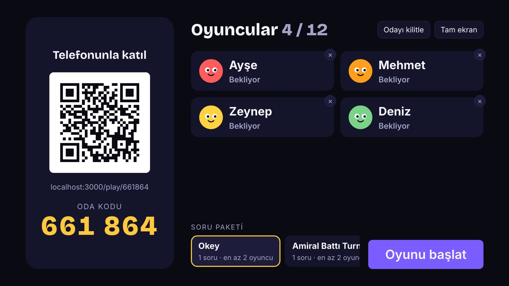

</div>

---

## 🕹️ Nasıl oynanır?

1. **📺 Host** odayı bilgisayardan açar ve ekranı TV'ye ya da projektöre verir.
2. **📱 Oyuncular** QR kodu okutur ya da 6 haneli oda koduyla telefon tarayıcısından katılır.
3. **🎮 Oyun** yönetim panelinde hazırlanan bir oyun paketinden oynanır. Bir pakette farklı
   oyunlardan bölümler olabilir. Skorlar, süreler ve sonuçlar sunucuda; telefon sadece kumanda.

<table>
  <tr>
    <td width="70%">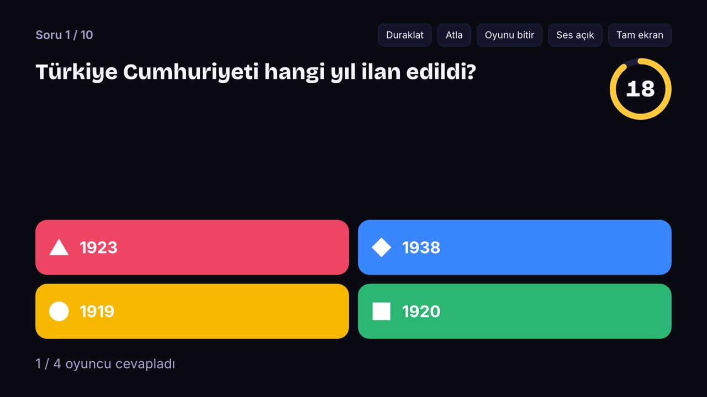</td>
    <td width="30%">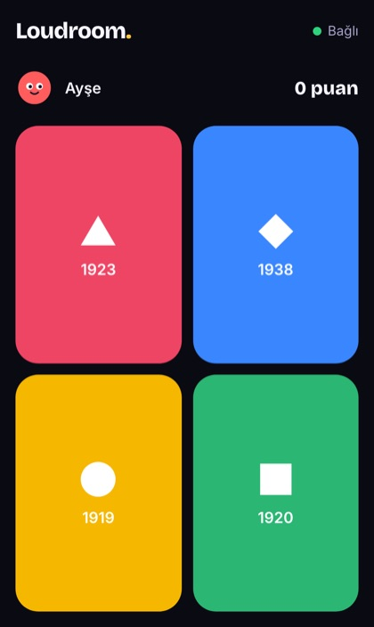</td>
  </tr>
  <tr>
    <td align="center"><sub>TV: soru, kalan süre, kaç kişinin cevapladığı</sub></td>
    <td align="center"><sub>Telefon: büyük, renkli cevap düğmeleri</sub></td>
  </tr>
</table>

## 🎲 Oyunlar

### Parti oyunları

Her bölüm kısa bir tur; tur sonunda skor tablosu, oyun sonunda podyum.

| Oyun                  | Kısaca                                                          |
| --------------------- | --------------------------------------------------------------- |
| ❓ **Quiz**           | 2–6 seçenekli sorular; görselli ya da videolu soru; seri bonusu |
| 🎯 **Closest Number** | Sayıyı tahmin et; en yakın tahmin kazanır                       |
| 🔢 **Sorting**        | Öğeleri doğru sıraya diz (sürükle-bırak)                        |
| 🙋 **Kim Yapar?**     | "Kim en çok geç kalır?" — oyuncular birbirine anonim oy verir   |
| 🗺️ **Image Location** | Haritada ya da görselde doğru noktayı işaretle                  |
| 🤥 **Bluff**          | Sahte cevap yaz, gerçeğini bul, başkalarını kandır              |
| 🎨 **Drawing**        | Biri çizer, diğerleri tahmin eder (canlı çizim akışı)           |
| ⚡ **Reaction**       | Hedef görününce en hızlı dokunan kazanır                        |
| 🧠 **Memory**         | Ekranda gösterilenleri hatırla, telefondan cevapla              |
| 🎱 **Tombala**        | Kartın telefonda; çinko ve tombala sunucuda doğrulanır          |
| 🕵️ **Casus Kim?**     | Herkes mekânı bilir, casus bilmez; tartış, oyla, casusu bul     |

### Kart ve masa oyunları

Bir maç tek uzun bölüm. Elin ya da filon yalnızca senin telefonunda, masa TV'de. Bağlantısı
kopan oyuncunun yerine bot oynar.

| Oyun                 | Kısaca                                                                |
| -------------------- | --------------------------------------------------------------------- |
| 🃏 **UNO**           | 2–10 kişi; +2 / +4 yığma ayarı, "UNO!" ve "Yakala!"                   |
| ♠️ **Pişti**         | 2–4 kişi, 4 kişide eşli; pişti, Vale piştisi, hedef puan              |
| 🎲 **Kızma Birader** | Zar sunucuda; klasik haç tahtası (6 kişilik varyant yuvarlak)         |
| 🚢 **Amiral Battı**  | Filoyu telefonda diz; iki takım ya da paralel düellolu turnuva        |
| 🀄 **Okey**          | 106 taş, gösterge ve okey; ıstaka yatay telefonda, boş koltuklara bot |

### 📸 Ekranlar

<table>
  <tr>
    <td>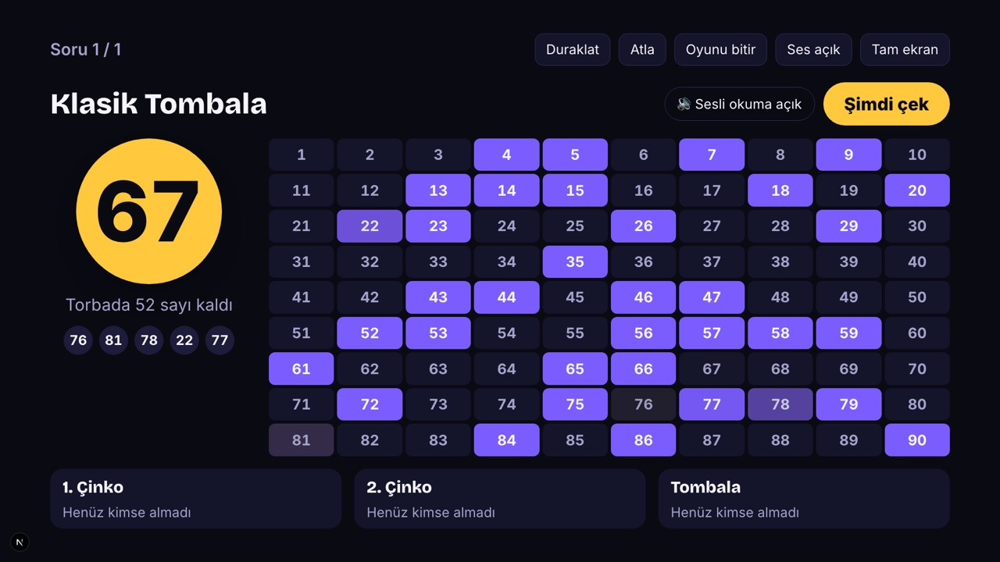</td>
    <td>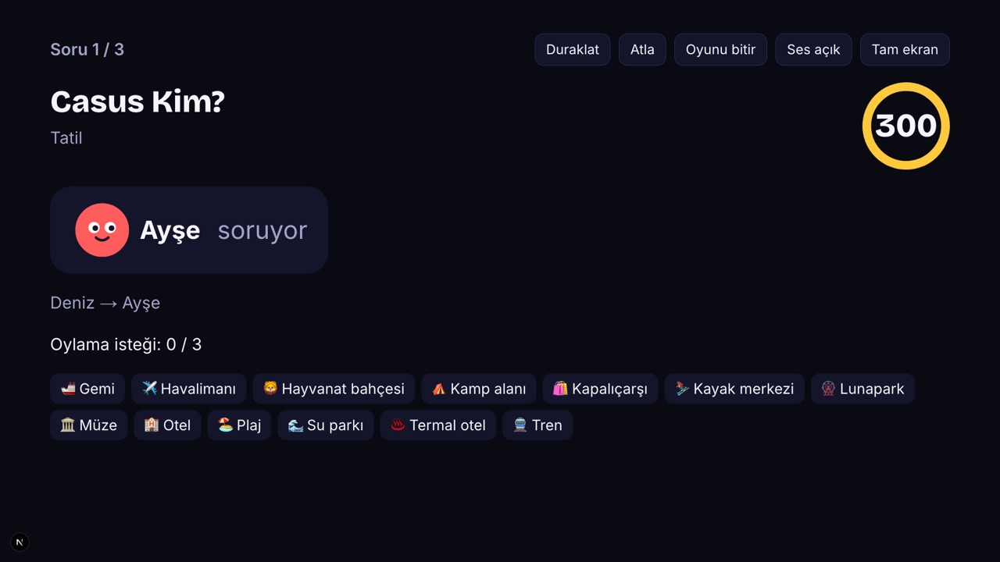</td>
  </tr>
  <tr>
    <td align="center"><sub>Tombala</sub></td>
    <td align="center"><sub>Casus Kim?</sub></td>
  </tr>
  <tr>
    <td>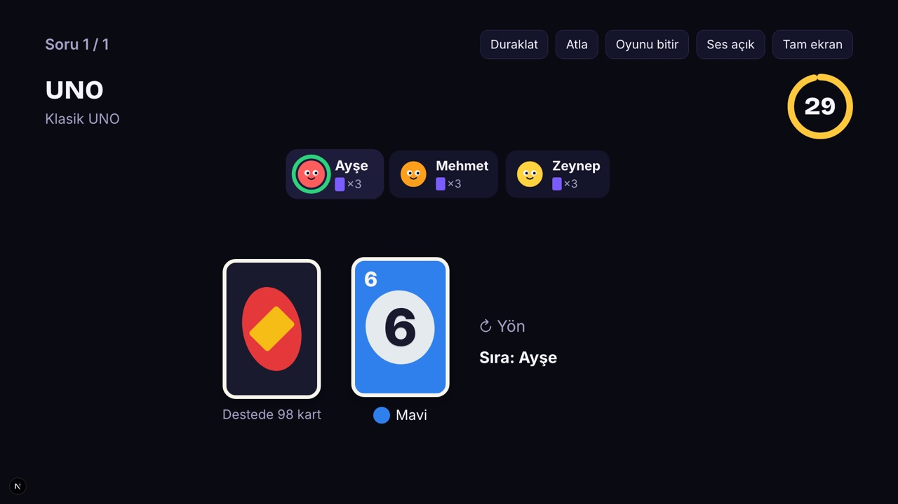</td>
    <td>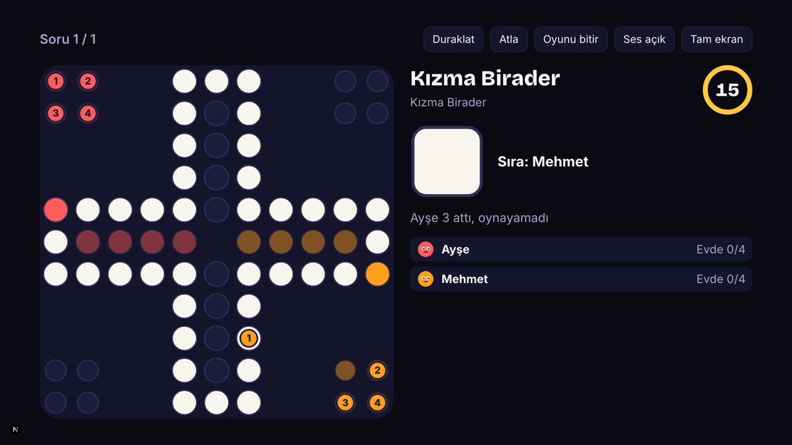</td>
  </tr>
  <tr>
    <td align="center"><sub>UNO</sub></td>
    <td align="center"><sub>Kızma Birader</sub></td>
  </tr>
  <tr>
    <td>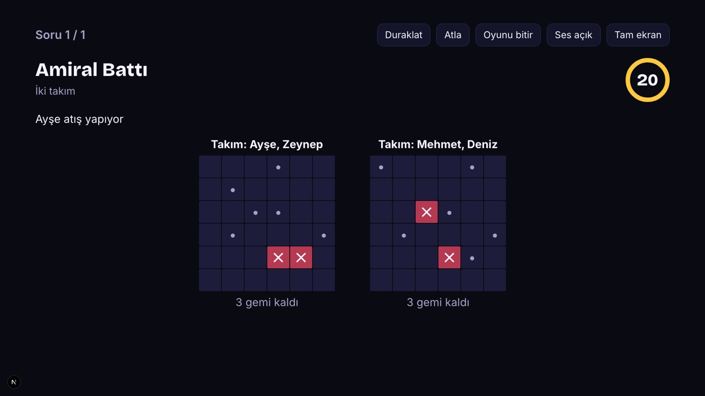</td>
    <td>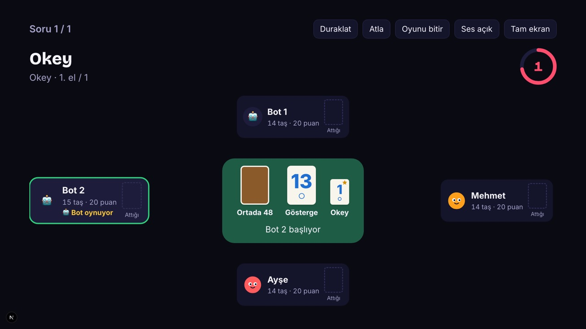</td>
  </tr>
  <tr>
    <td align="center"><sub>Amiral Battı</sub></td>
    <td align="center"><sub>Okey</sub></td>
  </tr>
  <tr>
    <td>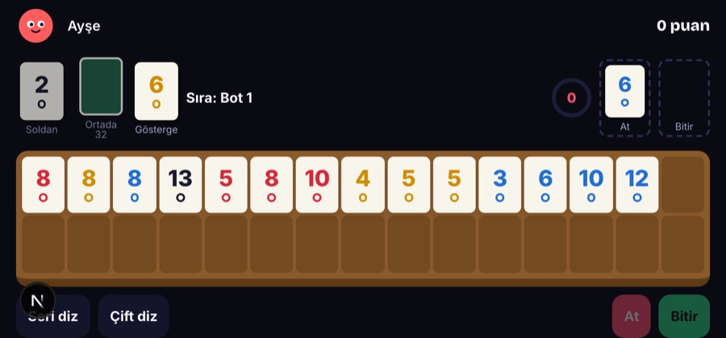</td>
    <td>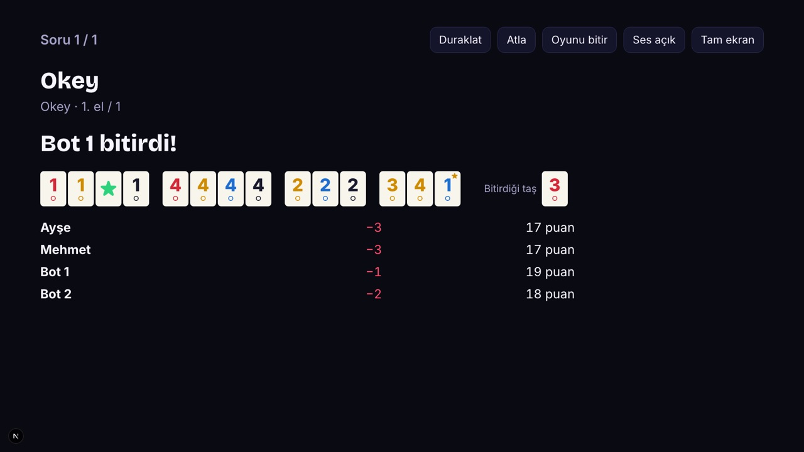</td>
  </tr>
  <tr>
    <td align="center"><sub>Okey: yatay telefonda ıstaka (sürükle-bırak)</sub></td>
    <td align="center"><sub>Okey: el sonu tablosu</sub></td>
  </tr>
</table>

## ✨ Özellikler

- 🔒 **Sunucu belirler:** Skor, zamanlayıcı ve faz geçişleri yalnızca sunucuda. Doğru cevap,
  gizli el, deste sırası ve zar sonuç anından önce hiçbir istemciye gitmez; her oyun için
  bunu doğrulayan ortak sözleşme testleri var.
- 🔄 **Yeniden bağlanma:** Sayfa yenilenince ya da bağlantı kopunca oyuncu aynı yerine döner.
  Host koparsa oyun duraklar; kart oyunlarında kopanın yerine bot oynar.
- 🛠️ **Yönetim paneli:** İçerik, kategori, medya (görsel ve video), oyun paketleri,
  kullanıcılar (ADMIN / EDITOR), CSV/XLSX ile toplu içe aktarma, oyun geçmişi ve
  istatistikler.
- 🛡️ **Güvenlik:** Rate limit, oda kodu deneme koruması, küfür filtresi, argon2 ile şifre,
  httpOnly + SameSite=Strict oturum çerezi ve CSRF koruması, yüklenen dosyalarda meta veri
  silme.
- 🧾 **KVKK:** Oyuncular hesapsız; oyun geçmişi ayarlanabilir süre sonunda silinir.
- 🚀 **Prod:** Nginx arkasında Docker Compose, yedekleme ve geri yükleme betikleri, GitHub
  Actions CI ([docs/DEPLOY.md](docs/DEPLOY.md)).

## 🏗️ Mimari

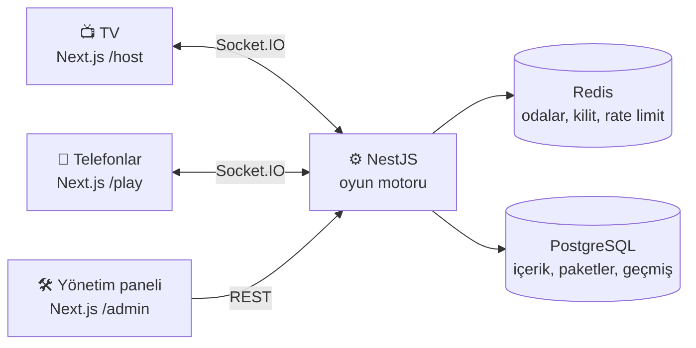

Her oyun `packages/games/` altında ayrı bir paket: kurallar saf ve senkron bir modül, TV ve
telefon ekranları, içerik editörü. Zamanlayıcıları, kalıcılığı ve yayını oyun motoru yapar.

| Katman   | Teknoloji                                                                                  |
| -------- | ------------------------------------------------------------------------------------------ |
| Monorepo | pnpm workspaces + Turborepo, Node 24, TypeScript (strict)                                  |
| Web      | Next.js 16 (App Router), React 19, Tailwind CSS 4, Motion, next-intl                       |
| Server   | NestJS 12, Socket.IO (Redis adapter), REST, zod                                            |
| Veri     | PostgreSQL 16 + Prisma 7, Redis 7                                                          |
| Medya    | sharp (görseller), ffmpeg / ffprobe (videolar)                                             |
| Test     | Vitest (unit + gerçek Postgres/Redis üzerinde integration), Playwright (Chromium + WebKit) |

## 🚀 Hızlı başlangıç

Gerekenler: **Node 24**, **pnpm 12**, **Docker**.

```bash
cp .env.example .env            # bir kez
docker compose up -d --wait     # postgres, redis, server :4000, web :3000
```

| Ekran        | Adres                         |
| ------------ | ----------------------------- |
| 📺 Host (TV) | <http://localhost:3000/host>  |
| 📱 Oyuncu    | <http://localhost:3000/play>  |
| 🛠️ Yönetim   | <http://localhost:3000/admin> |

- Telefonla denemek için `.env` içindeki `PUBLIC_URL`'i bilgisayarın LAN adresine ayarla.
- Geliştirme yönetici hesabı `.env` içindeki `ADMIN_SEED_EMAIL` / `ADMIN_SEED_PASSWORD`.

<details>
<summary><b>Docker olmadan, bilgisayarda çalıştırmak</b></summary>

```bash
pnpm install
pnpm infra:up                   # yalnızca postgres + redis
pnpm db:migrate && pnpm db:seed
pnpm dev                        # server + web + paketler, izleme modunda
```

Video yüklemek için `ffmpeg` gerekir (`brew install ffmpeg`); Docker ortamında hazır gelir.

</details>

<details>
<summary><b>Komutlar</b></summary>

```bash
pnpm typecheck                  # TypeScript
pnpm lint                       # ESLint
pnpm test                       # unit + integration (postgres + redis gerekir)
pnpm build                      # bütün paketler ve uygulamalar
pnpm test:e2e                   # Playwright (çalışan stack gerekir)
pnpm format:check               # Prettier

pnpm db:migrate                 # migration oluştur / uygula
pnpm db:seed                    # örnek içerik, paketler ve geliştirme admin'i (idempotent)
pnpm admin:create --email sen@ornek.com --name "Ad"   # ilk yönetici; --reset ile şifre sıfırlama

scripts/prod.sh up -d --build --wait   # prod stack (.env.prod ile); ayrıntılar docs/DEPLOY.md
scripts/backup.sh                      # yedek al; geri yükleme: scripts/restore.sh <dump> <tar>
```

8 GB belleği olan bilgisayarlarda `typecheck`, `lint`, `test` ve `build` komutlarına
`--concurrency=4` ekle (CI de böyle çalışır).

</details>

<details>
<summary><b>Klasör yapısı</b></summary>

```
apps/
  server/          NestJS — REST API, Socket.IO gateway, oyun motoru, admin API
  web/             Next.js — /host (TV), /play (telefon), /admin (panel)
packages/
  shared/          zod şemaları, socket olay ve REST sözleşmeleri
  game-sdk/        oyun modülü sözleşmesi, ortak test paketi, ortak istemci bileşenleri
  table-kit/       kart ve masa oyunları: koltuklar, sıra, bot, deste, zar, paralel sıralar
  games/*          her oyun ayrı paket: kurallar, TV ve telefon ekranları, içerik editörü
docker/            geliştirme ve prod imajları, Nginx, postgres init, yedekleme
scripts/           prod, smoke test, yedekleme ve geri yükleme
docs/SPEC.md       teknik şartname
docs/DEPLOY.md     prod kurulumu
```

</details>

<details>
<summary><b>Yeni bir oyun eklemek</b></summary>

`packages/games/` altında yeni bir paket ve server ile web registry'lerine birer satır. Her
oyun ortak sözleşme testlerini geçmek zorunda (cevap ve gizli bilgi sızıntısı testleri dahil).
Ayrıntılar [CLAUDE.md](CLAUDE.md) ve [SPEC §5](docs/SPEC.md)'te.

</details>

## 📈 Durum

SPEC'teki **13 fazın hepsi tamamlandı**: altyapı, oda ve lobi, oyun motoru, yönetim paneli, 16
oyun, içe aktarma, oyun geçmişi ve istatistikler, videolu sorular, prod kurulumu, yedekleme ve
CI. Son çalıştırmada 747 unit/integration testi ve Chromium + WebKit'te 50 uçtan uca test
geçti.

Ürünün ve mimarinin tek doğru kaynağı [docs/SPEC.md](docs/SPEC.md); her fazın kararları,
testleri ve bilinen sınırları [PROGRESS.md](PROGRESS.md) içinde.

## 📜 Lisans

Loudroom, [GNU Affero General Public License v3.0](LICENSE) (AGPL-3.0-or-later) ile lisanslıdır.
Kodu kullanabilir, değiştirebilir ve dağıtabilirsin. Değiştirilmiş bir kopyayı ağ üzerinden
servis olarak çalıştırıyorsan, kullanıcılarına o kopyanın kaynak kodunu da aynı lisansla sunmak
zorundasın. Ana sayfadaki "Kaynak kodu" linki bunun içindir: kendi kopyanda `SOURCE_CODE_URL`'i
kendi yayımladığın kaynağa ayarla.

Copyright © 2026 Adem
